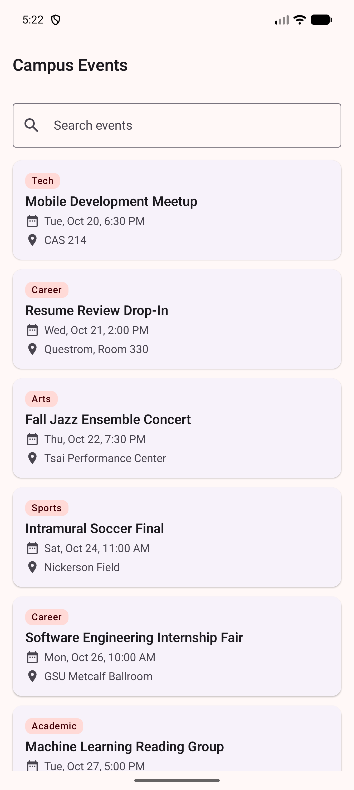

# Campus Event Explorer

**Name:** Aayush Kumar
**Assignment:** Individual Assignment 3, Campus Event Explorer
**Package:** `io.github.aayushhks.campuseventexplorer`

A two screen Jetpack Compose app for browsing ten campus events. The list screen
has a search field and a `LazyColumn` keyed by event ID. Tapping an event opens
its detail screen, which has an Up button and a Share event button.

## Running it

Open the `Practice_3` folder in Android Studio, let Gradle sync, and run on an
emulator (I used Medium Phone, API 36).

```bash
./gradlew testDebugUnitTest          # filtering and share text
./gradlew connectedDebugAndroidTest  # rotation sequence, Up, invalid ID, share intent
```

`RotationAndStateTest` runs the nine step rotation and state sequence from the
assignment.

## Screenshots

| List | Detail |
|---|---|
|  |  |

## Questions

**1. Why does the route contain an event ID instead of the complete event object?**
The ID is the event's identity and the event collection is the source of truth.
A `Long` is cheap to save in the back stack and restore after rotation, and the
detail screen always looks up the current event. A whole object would be a copy
that can go stale and would need a custom `NavType`.

**2. Which composable owns the search state?**
`EventListRoute`, the content of the `composable<EventList>` destination. It
passes `query` and `onQueryChange` down to `EventListScreen`, which holds no state.

**3. Why does the search value use rememberSaveable?**
Rotation recreates the Activity. `remember` would reset the query, but
`rememberSaveable` writes it to saved instance state. Since it is scoped to the
list's back stack entry, it is also still there after coming back from a detail.

**4. What happens to the back stack when an event is selected?**
`navigate(EventDetail(id))` pushes a detail entry on top, so the stack becomes
`[EventList, EventDetail(id)]`. The list entry stays below with its saved state.
Back or Up pops the detail entry. `launchSingleTop` stops a double tap from
stacking two copies.

**5. How does the UI request navigation without directly accessing the NavController?**
Screens only take callbacks like `onEventSelected: (Long) -> Unit` and
`onBack: () -> Unit`. `CampusEventApp` owns the `NavController` and passes lambdas
that call `navigate` or `popBackStack`.

**6. What makes the Share action an implicit intent?**
It names an action (`ACTION_SEND`) and a type (`text/plain`) but no component.
Android finds every app that can handle it, and `Intent.createChooser()` lets the
user pick one.

## AI Disclosure

I used AI assistance to help me understand Kotlin Serialization, Espresso Intents,
and UI Automator, including their use in type-safe navigation, share-intent
testing, and rotation testing.
